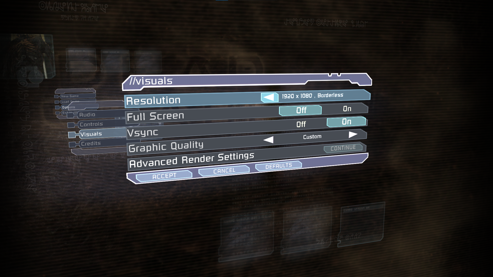
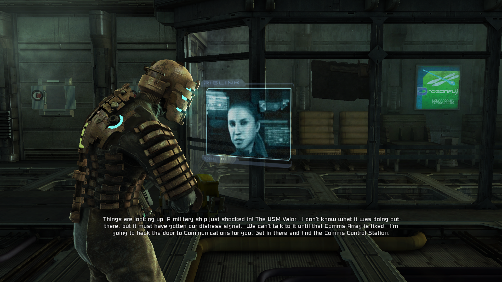
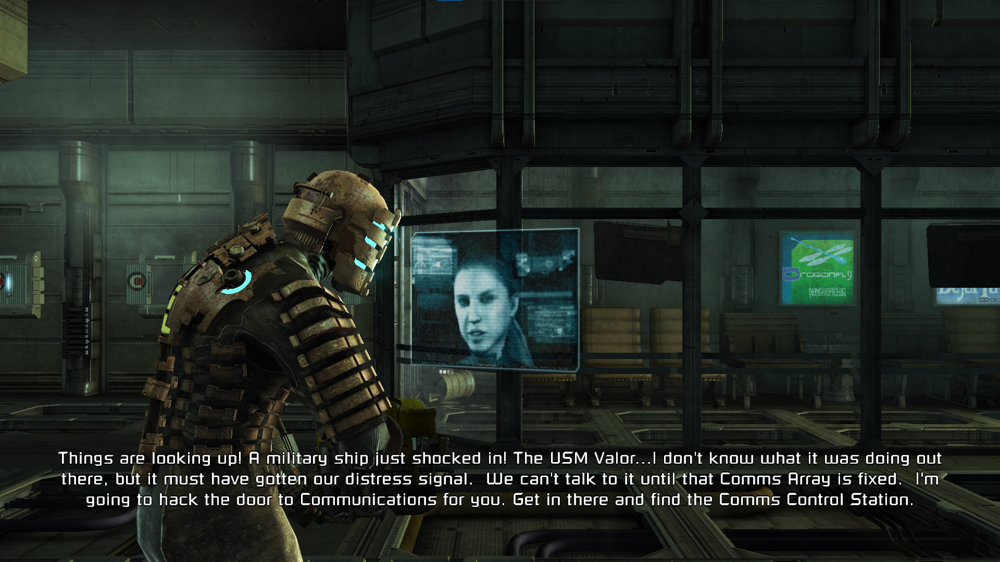
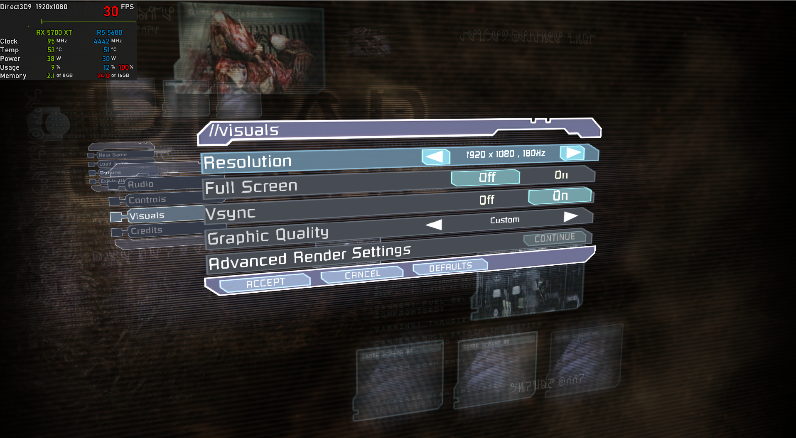
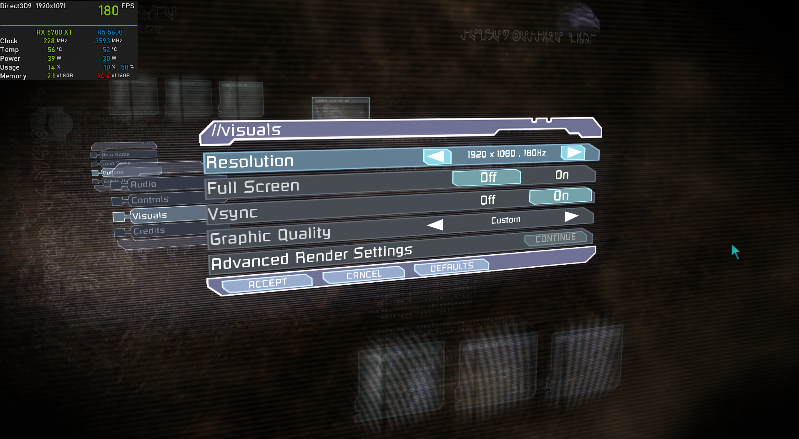

<p align="center">
  
</p>

<p align="center">A mod for Dead Space (2008) that adds numerous fixes and improvements<p>

# Features 

## Borderless Windowed
Adds a option to enable borderless when the game is set in windowed to the resolution list (the old implementation of borderless is avaliable if you enable LegacyBorderlessWindowed in the INI)
<p align="center">
  
</p>

## High FPS Fixes
Most issues at high FPS are fixed, the big ones are the game no longer slows down the higher FPS, kinesis works properly, and scripting issues are fixed.

## Anisotropic Filtering
Hooks the D3D texture sampler to force 16x anisotropic filtering. This has zero performance loss on modern hardware and hugely improves texture clarity.
<div align="center">
  <table>
    <tr>
      <td width="10%"></td>
      <td width="10%"></td>
    </tr>
    <tr>
      <td align="center">On</td>
      <td align="center">Off</td>
    </tr>
  </table>
</div>

## (Experimental) Fixed Crashes on 10+ Core CPUs
The crashes on modern 10+ core CPUs should be fixed. (I do not own a 10+ core CPU to 100% confirm, but there's no reason for the patch not to work).

## Significantly Faster Startup Times
Removed the insanely slow check for legacy DirectInput8 devices; this saves about 3 seconds off the boot time! (depends on how many HID devices are connected) This does mean the game won't pick up steering wheels or pre-2007 joysticks, but any modern Xbox/PlayStation controllers running through XInput will still work perfectly.

## High Resolution Subtitle Fix
Fixes the too small subtitles at resolutions above 720p; no need to squint to see subtitles at 4k anymore!
<div align="center">
  <table>
    <tr>
        <td width="10%"></td>
        <td width="10%"></td>
    </tr>
    <tr>
      <td align="center">Vanilla 4k</td>
      <td align="center">DeadSpaceFixes 4k</td>
    </tr>
  </table>
</div>

## Mouse Sensitivity Fix
Normally the mouse sensitivity is tied to game's FPS, which means at 60+ FPS the sensitivity heavily slows down, this is fixed. Deadzones and acceleration have also been removed. If you don't like how the camera feels after this set `FixMouseSensitivty=1` in `DeadSpaceFixes.ini` to `FixMouseSensitivty=0`

## Improved Anti-Aliasing
The anti-aliasing option in the game has been replaced with FXAA, and you can use `SSAAScale` in the `DeadSpaceFixes.ini` to enable FXAA.

## Fixed fullscreen brightness
In the fullscreen the brightness is normally far higher than it should be (no clue how it got past QA) and this has been fixed. It's most noticable in the main menu

## Safer Save String Handling
Improved the save string handling; Viceral had left an issue where it would clear 128 bytes rather than 128 wide characters (256 bytes), which would cause garbage data and could cause issues and crashes.

## Removed Telemetry
Removed some random telemetry that would tell EA what OS you are on and get your device MAC address. This will make the game fully offline and reduce startup times a bit.

## Native PS4/5 & Switch Controller Support
The game now supports PS4/5 and Nintendo switch controllers using SDL3.

## Fixed VSync In Windowed Mode
The 30 FPS cap on VSync when in windowed mode has been removed, and VSync has been properly implemented in windowed mode as normally it never enables VSync and instead just cpas the FPS. In fullscreen the game normally uses half-rate VSync so it runs at half your refresh rate, it has been changed to standard VSync.

<div align="center">
  <table>
    <tr>
        <td width="10%"></td>
        <td width="10%"></td>
    </tr>
    <tr>
      <td align="center">Vanilla VSync on 180hz display</td>
      <td align="center">DeadSpaceFixes VSync on 180hz display</td>
    </tr>
  </table>
</div>

## (Optional) 60 FPS Cap
Simply change `SafeFPSCap=0` to `SafeFPSCap=1` in the `DeadSpaceFixes.ini`

## (Optional) Skip Ishimura Landing Cutscene
Skips the Ishimura landing cutscene to help with speedrunning the game.
  
## (Optional) Skip Intro To Main Menu
Skips the boot intro and lands directly on the main menu. Set `SkipIntroToMainMenu=1` in the config file.

## (Optional) Impossible Difficulty Unlocked Without Playthrough
You can use impossible difficulty with having the play through the full game first.

## (Optional) Movable Main Menu Camera
You can use your mouse to move the main menu camera if you set `MouseMenuCamera=1` in the `DeadSpaceFixes.ini`

## (Optional) Skip Loading Screen Delay
Shortens the artificial wait on the loading screen once the level has finished loading when starting a new game. The vanilla game holds the loading screen on a ~30 second tip-cycling loop even after the level is ready; this cuts that hold to ~3 seconds, so the loading tips still appear but the screen drops almost immediately. Set `SkipLoadingScreenDelay=1` in the config file.

## Loose Lua Script Loader
`.lua` and `.luac` scripts are now loaded from a folder named `scripts` next to the `.exe`. I got Claude to do a Lua function dump in [docs/LuaFunctions.md](docs/LuaFunctions.md) that you can use to write your own scripts.

## Loose SimGroup Loader
Loose SimGroups (`.sgp`) are loaded from a folder named `simgroup_mods` next to the `.exe`. You can use this to modify lots of things with the game, and they are editable with [VisceralToolkit](https://github.com/Greavesy1899/VisceralToolkit).

***Credit to [Greavesy1899](https://github.com/Greavesy1899)***


# Install Guide

> [!NOTE]  
> Requires at least Windows 7 SP1 x86 and a CPU with SSE2 support.
>
> **Download** [DeadSpaceFixes](https://github.com/seamusduncmcgrath/DeadSpace2008Fixes/releases/latest/download/xinput1_3.dll)
> 
> Simply add the `xinput1_3.dll` file you downloaded from above into the game folder next to `Dead Space.exe`, and if it worked you should see "DeadSpaceFixes Installed!" in the bottom right of the main menu instead of the version number.


# Config
Some settings can be enabled or disabled using `DeadSpaceFixes.ini`. Create this file in the game directory and add the following: (unless it already exists)

```ini
[Settings]
[Info]
ConfigVersion=5
[Fixes]
; Fix vsync behaviour
FixVSync=1
; Fix subtitle scaling
FixSubtitleScale=1
; Patch out the game's DInput8 DLL usage
PatchOutDInput8=1
; Skip the artificial wait on the loading screen once the level is ready
SkipLoadingScreenDelay=1
[Patches]
; Run the game in a borderless window instead of fullscreen
BorderlessWindowed=1
; Disable the game's telemetry/data collection
RemoveTelemetry=1
; Skip the Ishimura landing cutscene on new game (plus) start
SkipIshimuraLandingCutscene=0
; Skip the boot intro and launch main menu immediately
SkipIntroToMainMenu=1
; Make newly-triggered lore/vidlog videos skippable with F
SkipLoreVideos=0
[Features]
; Cap the framerate to avoid physics/script issues
SafeFPSCap=0
; Allows you to move the main menu camera with a mouse, normally you have to use a controller.
MouseMenuCamera=0
```

## Credits
- [SDL3](https://github.com/libsdl-org/SDL) for the PS4/PS5 and switch controller support.
- [MinHook](https://github.com/tsudakageyu/minhook) for hooking.
- [SuiMachine](https://github.com/SuiMachine/Dead-Space---Intro-Skip) for the original intro skip mod.
- [MarkerPatch](https://github.com/Wemino/MarkerPatch) for the save string handling fix and reverse engineering references.
- [GF2ASI](https://github.com/Omerta-Labs/GF2ASI) for the loose SimGroup loader

